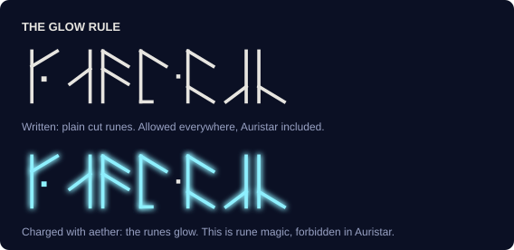
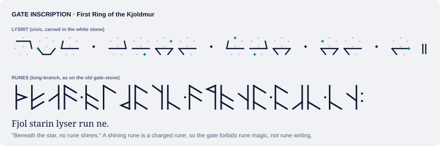
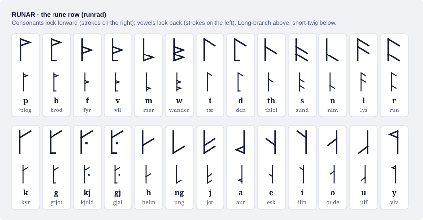
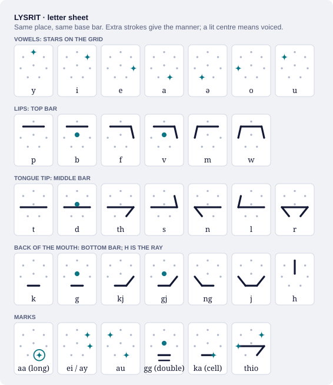
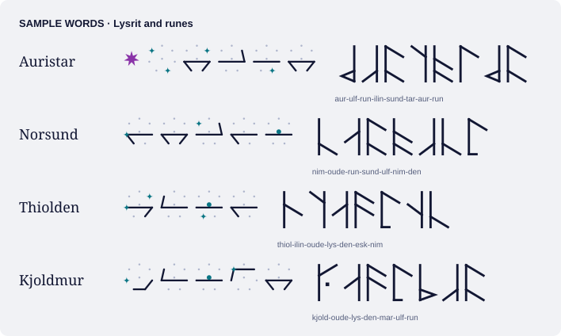
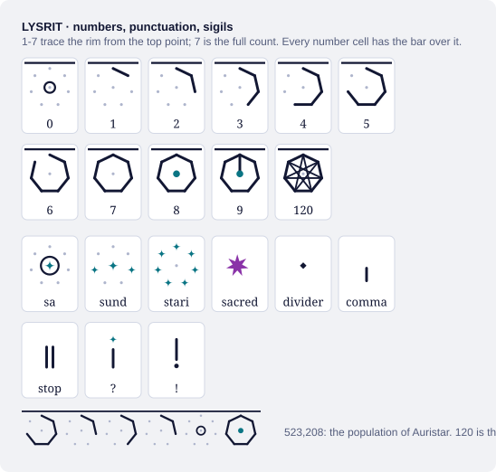
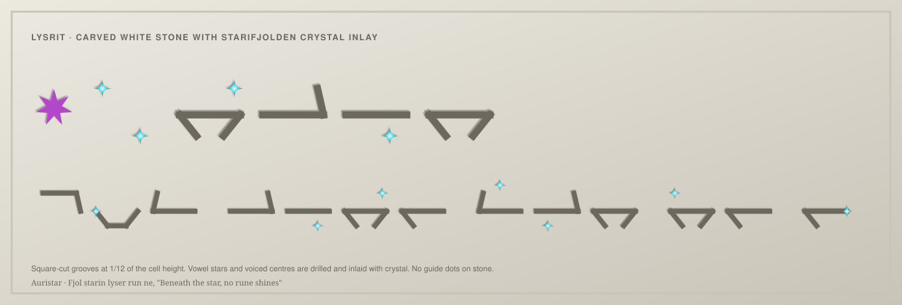
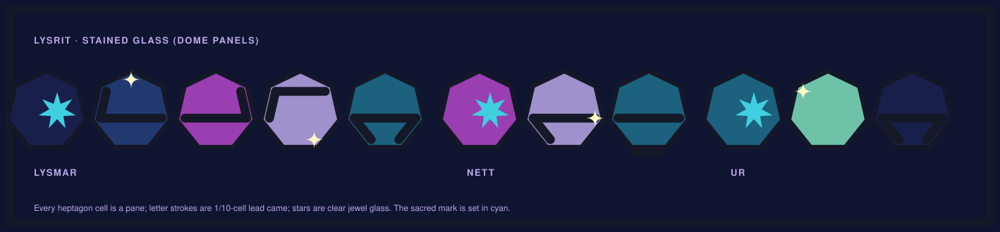
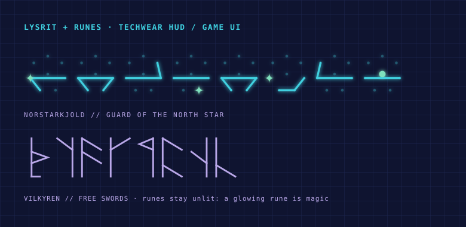
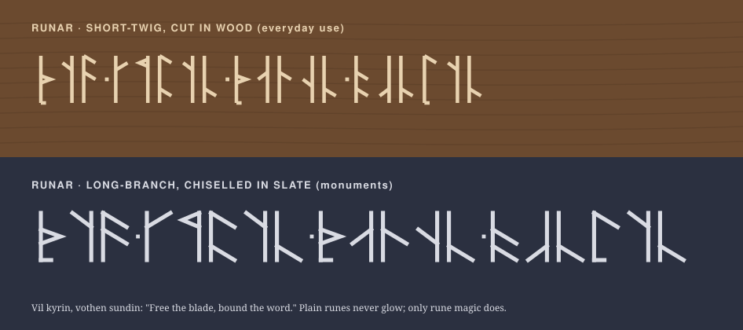

# Writing Norsund: runes and Lysrit

Norsund has two native scripts with different jobs. This guide is for writers, artists and game designers. The formal specifications are [`records/languages/scripts/runar.yaml`](../../../records/languages/scripts/runar.yaml) and [`lysrit.yaml`](../../../records/languages/scripts/lysrit.yaml).

| | Runes (runar) | Lysrit ("light-writing") |
|---|---|---|
| Who uses it | everyone in Thiolden, Auristar included | Auristar's temples, the Lights, civic monuments |
| What it's for | everyday writing: slates, signs, letters, tallies, woodwork, boundary stones | holy names, decrees, inscriptions on the Kjoldmur, temple glass |
| Look | straight cut staves with branches, no curves | constellations: strokes between the seven points of Auristar's star, vowels as stars |
| Origin | inherited from the Old Norsund settlers of Farheim | designed by Starlight Library scholars, c. 99–124 a.v.e. |
| Magic | becomes rune magic only when charged with aether, and then it **glows** | never magical |
| Fonts | `Runar-Regular.otf` (stone), `Runar-Twig.otf` (wood) | `Lysrit-Regular.otf` |

In English-language lore, Norsund is written in its plain ASCII romanization. Use the native scripts in art, props, inscriptions and UI flavour, not in running prose.

## The glow rule

- A rune that is cut, inked, embroidered or inlaid is ordinary writing. Anyone may write runes anywhere, including in Auristar.
- A rune becomes magic only when its carver charges it with aether. **Charged runes glow**, and glow is the only visual sign of rune magic.
- Auristar forbids rune magic, not rune writing. **In Auristar, runes never glow.** A glowing rune in the city is a crime scene.
- Auristar characters may wear runes as trim, embroidery or engraving, never glowing. Their glowing marks, if any, are Lysrit stars or Starifjolden crystal.

The Kjoldmur's gate says it in one line: *Fjol starin lyser run ne*, "Beneath the star, no rune shines."

## Runes

### How the runes work

- Every rune is a vertical **stave** with strokes on one side only.
- **Consonants look forward**: their strokes are on the right. **Vowels look back**: their strokes are on the left. A line of runes alternates between the two, which makes it quick to read.
- The kind of stroke shows where the sound is made:
  - lips: a **bow** (a small pennant) — p b f v m w
  - tongue tip: a **falling branch** — t d th s n l r
  - back of the mouth: a **rising branch** — k g kj gj h ng j
- The height of the stroke shows how the sound is made. Stops sit at the top, fricatives in the middle and nasals at the bottom. Liquids and glides use two strokes.
- A **heel** at the foot of the stave makes a stop or fricative voiced (t → d, k → g, p → b, f → v).
- A **dot** beside k or g makes kj or gj.
- The rune row (runrad) has 24 staves and 26 letters. Each rune is named after a Norsund word that begins with its sound: kyr "blade" for k, lys "light" for l, thiol "brave" for th. The ng rune is named *ung* "offspring", because no word starts with ng.

### Spelling with runes

1. Write the word in the romanization: `Kjoldmur`.
2. Split it into rune letters, with th, kj, gj and ng as one rune each: `kj · o · l · d · m · u · r`.
3. Cut one rune per letter from left to right. Doubled letters are cut twice; diphthongs (ei/ay, au, ou) are two runes.
4. Put a dot (·) between words and two dots (:) at the end of a sentence, as on old runestones.

Letters that aren't in Norsund are spelled out: c and q become k, x becomes k + s, z becomes s.

### Long-branch and short-twig

- **Long-branch** runes are cut in stone and anything meant to last: monuments, boundary stones, the old gate-stone of the Kjoldmur.
- **Short-twig** runes are a quick form for wood, bone and everyday notes. Every stroke is pulled halfway toward the stave.
- Both spell exactly the same way. A carpenter's tally and a lord's monument use the same alphabet in different hands.

### Numbers in runes

Runes have no digit signs. Numbers are written as words, or in merchants' tallies with one group per decimal digit:

- One to four are short notches.
- Five is a "hand", a long stroke slanted across four notches.
- Six to nine are a hand followed by notches.
- Zero is a short level dash.

Vilnayan merchants also count goods in long hundreds (langhaun, 120).

## Lysrit

### How Lysrit works

Every Lysrit letter is drawn on the grid of **Auristar's seven-pointed emblem**: seven points on a circle, top point up, plus the centre.

- **Consonants** are straight strokes between the points. Sounds made in the same part of the mouth share a **base bar**:
  - lips: the top bar
  - tongue tip: the middle bar
  - back of the mouth: the bottom bar
  - h: the ray from the top point to the centre
- Extra strokes show *how* the sound is made. A **lit centre** (the emblem's cyan heart) means voiced, as in b, d, g, v and gj.
- **Vowels are stars** on a point of the grid, laid out like a vowel chart. Front vowels sit on the right, back vowels on the left and the low vowel at the bottom. The top point is y.
- One consonant and the vowel stars that follow it share **one cell**, so each word looks like a small constellation.

### Writing a word in Lysrit, step by step

Take *Kjoldmur*:

1. Split it into consonants and vowels: `kj o l d m u r`.
2. Group each consonant with the vowels right after it: `kj[o] l d m[u] r`. That makes five cells.
3. Draw each cell on the grid: the consonant's strokes, the lit centre if it is voiced (d), then the vowel stars.

More rules:

- A vowel with no consonant before it gets an empty cell of its own, like the first cell of *Auristar*, `[au]`.
- A doubled consonant is one cell with a short **bar under** it. A doubled vowel is one star with a **ring**.
- An unstressed *e* in the last syllable is drawn as **ə** at the lower-left point. In *Thiolden* the d-cell holds ə, not e. Lysrit marks a difference the romanization doesn't.
- Put the **violet seven-pointed star** before holy names: Auristar, Ur, Nett, Myr, Heid, Lysmar, Naum, Fyren/Firen, Stevlysen, Norstar, Stardul.

### Numbers, punctuation and sigils

- Every number cell carries a **bar over the top**. Adjacent digits share one bar, and digits are written most significant first.
- One to seven trace the heptagon's rim clockwise from the top point; **seven is the closed heptagon, the "full count"**. Eight lights the centre, nine adds the ray to the top point, and zero is a hollow centre (*nuth*, the void).
- The **long hundred** (120) is the heptagon with Auristar's star drawn inside it.
- **Punctuation:** a small diamond divides words in inscriptions; there are also a comma, a full stop (two strokes), a question mark and an exclamation mark.
- **Evidential sigils** may close a sentence instead of the written particle:
  - *sa* "I saw it" is an eye.
  - *sund* "so it is sung" is three stars across the middle.
  - *stari* "so the stars say" is a star on every point.

### Inscriptions, the scribal hand and light-writing

- **Carved inscriptions:** cut the strokes as V-grooves in the white stone, drill the grid points, and set the vowel stars and lit centres with Starifjolden crystal. Divide words with the diamond.
- **Scribal hand:** Starlight Library scribes write fast, without grid points. Stars become dots and each cell's last stroke runs into the next. Holy names are always written in full cells, never in the fast hand.
- **Light-writing:** Lysrit is made of points, so it can be written with lights alone. Lit windows or crystal studs at the grid points spell words across a tower face at night.

## Design rules for art

**Palette.** Ink is deep navy (#121733) on white stone. Stars and lit centres are cyan (#0a7584 on light, #8ef0ff on dark). The sacred mark is violet (#8a33a8). Charged runes glow cyan-white and appear only outside Auristar, or as evidence of a crime inside it.

**Stained glass (Auristar's domes).**
- Lysrit strokes become the lead lines, vowel stars become small cyan panes, and the lit centre becomes a jewel.
- The heptagon rim can be leaded as a frame around each cell.
- Use one cell per pane cluster and keep holy names whole.

**Carved white stone.**
- Lysrit for civic and sacred text, V-cut with drilled grid points and crystal-set stars.
- Long-branch runes for old or practical text: boundary stones, the guild marks of masons, the old Marheim stones.

**Techwear and fashion.**
- A Lysrit word reads well as a vertical strip of cells down a sleeve, strap or zipper placket. The grid points work as rivets or eyelets, and the stars as reflective or crystal studs.
- Runes suit edge trims, belt tooling and embroidered hems: short-twig on leather and cloth, long-branch on metal plates.
- Keep runes non-glowing on Auristar characters. Glow-in-the-dark or light-up details belong to Lysrit stars.

**Game UI.**
- Keep Lysrit cells at 24 px tall or larger and drop the grid points below that. Runes stay readable down to about 14 px.
- Use the fonts for text that changes. Use `tools/norsund/scripts.js` (`renderLysrit`, `renderRunes`) for textures, decals, loading screens and anything that must glow.
- Never let Norsund script stand alone where players need the meaning: pair it with the English line or a tooltip.

**Don't:**
- curve the runes;
- put strokes on both sides of a rune's stave;
- stack runes into bind-runes or monograms;
- make Lysrit into a wheel with spokes;
- reshape the seven-pointed star.

## Hate-symbol screening

Viking-style runes have a real-world problem: extremist groups have appropriated several historical runes and rune-like marks. The DDU rune row was designed to avoid them:

- **Avoided:** Othala/Odal (with or without wings), Algiz and the inverted "death rune", Tiwaz (the arrow), Sowilo (single or doubled), Wolfsangel, Hagal, the Black Sun, the Totenkopf, the Celtic cross, triskeles and sunwheels, and swastika-like composites and bind-runes of any of these.
- **No forks or crossings:** no DDU rune has strokes on both sides of its stave, so no rune can form a symmetric fork, an arrowhead, an X or a crossed stave.
- **No diamonds or bare zigzags:** no rune is a closed diamond, and none has a zigzag without a stave.
- **Naming:** the t rune is deliberately not called "tyr".
- **No bind-runes:** they are not part of the script.
- **Lysrit:** it has no spoked wheels or crossed circles.

**Screening record (2026-11-19).** All 26 rune forms (24 staves plus the dotted kj and gj) and all Lysrit letters were checked against the ADL Hate Symbols database entries listed above. None matches. The rule behind that result is enforced by tests in `tools/test/scripts.test.mjs`, which run in CI on every pull request:

- every rune is one straight stave with strokes on one side only;
- no stroke crosses the stave;
- no two runes are alike;
- no rune is the mirror image of another.

A rune that would bring back a fork, arrow, crossbar, diamond or zigzag fails the build.

**For new art that combines marks**, such as logos, emblems, merchandise or anything stacked or rotated, compare the finished composition against the [ADL Hate Symbols database](https://www.adl.org/resources/hate-symbols/search) before release. This is part of the art release checklist below.

## Production art direction

This is the design pass for Norsund 1.0: the treatment of both scripts in each medium of the Drunken Dragon visual brief. The glyph shapes are final. Every medium uses the same geometry (from `tools/norsund/scripts.js`); only the stroke, terminals, colour, inlay and glow change. `node tools/fonts/art_sheets.mjs` regenerates the reference sheets.

| Medium | Script | Stroke (share of cell height) | Terminals | Stars and voiced centres | Guide dots | Colour |
|---|---|---|---|---|---|---|
| Carved white stone (Kjoldmur, Starirauggheim) | Lysrit | 1/12, square-cut groove | square | drilled, inlaid with Starifjolden crystal | never | groove in shadowed stone; crystal cyan |
| Stained-glass domes | Lysrit | 1/10, lead came | round | clear jewel glass | the heptagon panes replace them | panes in navy, indigo, magenta, lilac, cyan, mint |
| Techwear and game UI | Lysrit and runes | 1/25 to 1/20 | round (Lysrit), square (runes) | lit mint | kept below 32 px per cell | cyan or lilac on deep navy; Lysrit may glow |
| Wood (everyday) | short-twig runes | 1/16 of rune height | butt-cut | none | none | cut wood, lighter than the surface |
| Slate and monuments | long-branch runes | 1/15 of rune height | square | none | none | pale stone on dark slate |
| Embroidery and laser-cut techwear | Lysrit | one thread or kerf | round | French knot or cut-through dot | never | thread or kerf in the garment's accent colour |

### Minimum sizes and spacing

- **Lysrit:** at least 24 px per cell on screen (32 px without guide dots) and 12 mm per cell when carved or printed. Leave half a cell between words and one cell after the sacred mark.
- **Runes:** at least 16 px tall on screen and 10 mm when carved. Leave one stave-width between runes and use the word divider (·) between words.
- **Pairs to protect:** the Lysrit consonants p, t and k differ only in bar height and length, so never squash a cell's height. k and kj, and g and gj, differ only by the palatal dot, which must stay at least 1.5 times the stroke width. The voiced centre must too.

### Colour and glow

- Lysrit stars may shine (crystal, light, emissive in a game) anywhere.
- Runes glow **only** when they are charged with aether, which is rune magic. In Auristar, art never shows a glowing rune outside a scene of forbidden magic.
- The sacred mark is violet or magenta on screen and cyan in glass. It goes only before holy names.

### Art release checklist

1. The text is correct: run `node tools/cli.mjs render lysrit "<text>"` (or `runes`) and compare it against the art.
2. Sizes and spacing follow the minimums above.
3. Runes are unlit unless the scene is rune magic.
4. Composite marks (logos, emblems, stacked or rotated glyphs) have been compared against the ADL Hate Symbols database.
5. Credit "Lysrit and Runar: The Drunken Dragon Universe" when the fonts are used (SIL OFL).

## Tools

- **SVG rendering:** `tools/norsund/scripts.js` renders both scripts and works in the browser or Node:
  - `renderLysrit(text, {sacred, theme, scale})`
  - `renderRunes(text, {variant: 'long' | 'short', glow, theme, scale})`
  - `transliterateRunes(text)`, which returns rune names such as `kjold-oude-lys-den-mar-ulf-run`
  - `lysritCells(word)`, which shows how a word splits into cells
- **Fonts:** the fonts and how to use them in CSS, Unity, Unreal and Godot are in [`tools/fonts/README.md`](../../../tools/fonts/README.md).
- **Specimens:** the images on this page are regenerated with `node tools/fonts/specimens.mjs`.
